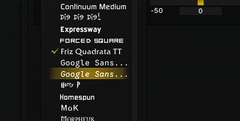
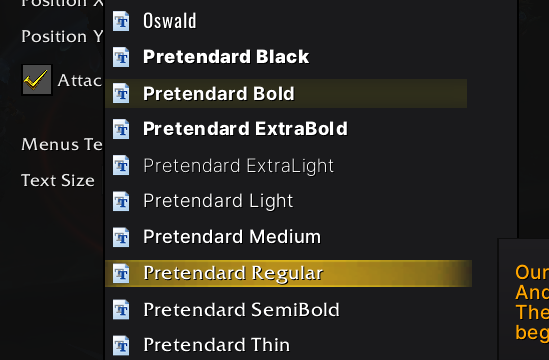
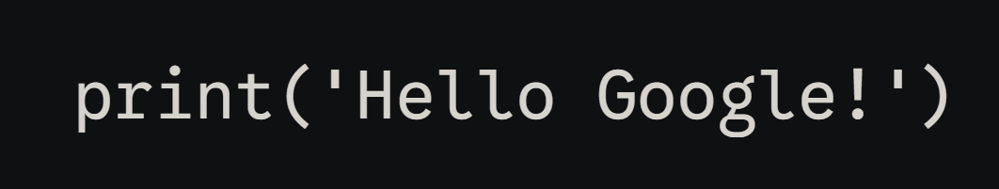

# SharedMedia_Criccafonts

Bundles two font families and registers them with
[LibSharedMedia-3.0](https://www.curseforge.com/wow/addons/libsharedmedia-3-0),
so any addon built on LSM can pick them from its media dropdown.

| Family | Faces | Locale flags |
| --- | --- | --- |
| Pretendard | Thin, ExtraLight, Light, Regular, Medium, SemiBold, Bold, ExtraBold, Black | koKR, western |
| Google Sans Code | Regular, Italic | western |

## Pretendard

A cross-platform UI typeface derived from Inter, Source Han Sans and M PLUS 1p,
with full Korean coverage.

<picture>
  <source media="(prefers-color-scheme: dark)" srcset="../images/pretendard-demo.jpg">
  
</picture>

- Source: <https://github.com/orioncactus/pretendard>
- License: SIL Open Font License 1.1 (`Pretendard_license.txt`)

## Google Sans Code

A monospaced family from Google, intended for code and tabular text.

- Source: <https://github.com/googlefonts/googlesans-code>
- License: SIL Open Font License 1.1 (`GoogleSansCode_OFL.txt`)

## Installation

Copy the `SharedMedia_Criccafonts` folder into
`World of Warcraft/_retail_/Interface/AddOns/`, or install it through your
addon manager once the package is published.

`LibSharedMedia-3.0` is embedded, so a separate copy is not required. Addons
that already ship LSM will simply reuse the loaded version.

## Media names

Registered names are stable and intentionally match the historical standalone
packages, so saved profiles keep working:

- `Pretendard Thin`, `Pretendard ExtraLight`, `Pretendard Light`,
  `Pretendard Regular`, `Pretendard Medium`, `Pretendard SemiBold`,
  `Pretendard Bold`, `Pretendard ExtraBold`, `Pretendard Black`
- `Google Sans Code`, `Google Sans Code Italic`

If you still have `SharedMedia_Pretendard` or `SharedMedia_GoogleSansCode`
installed, disable them. Leaving both enabled registers duplicate entries for
the same names.

## Adding a face

`Core.lua` is table driven: add the weight to the family's `faces` list (or add
a `{ name, file }` pair for an irregular file name) and the registration loop
handles the rest.

## License

The addon code is MIT licensed; see `LICENSE`. The bundled fonts are **not**
MIT: they remain under the SIL Open Font License 1.1. See
`THIRD_PARTY_NOTICES.md` for details.
